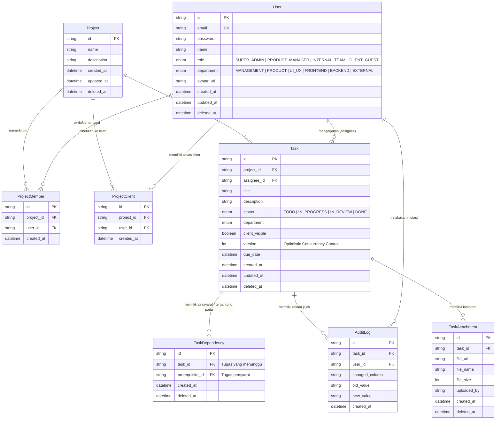
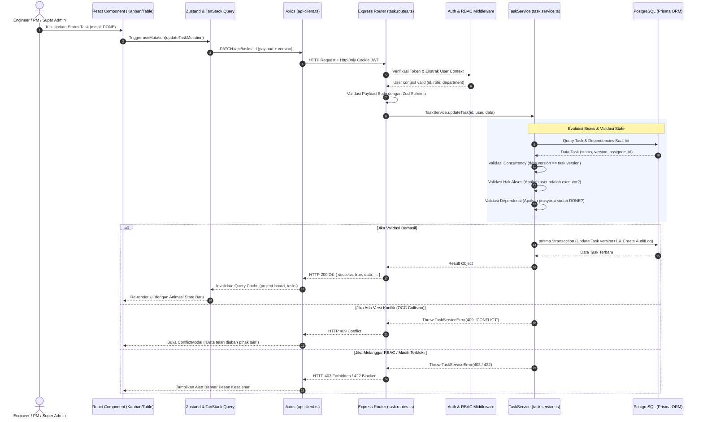

# DOKUMENTASI LENGKAP PROJEK: RELAY TASK MANAGEMENT ENGINE

Dokumentasi komprehensif mengenai arsitektur sistem, teknologi, modul fungsional, alur kerja setiap aktor (*Super Admin*, *Product Manager*, *Internal Team*, *Client Guest*), mekanisme kerja kode (*internal code logic*), spesifikasi API, dan alur eksekusi (*end-to-end data pipeline*).

---

## DAFTAR ISI
1. [Ringkasan Eksekutif & Gambaran Umum Sistem](#1-ringkasan-eksekutif--gambaran-umum-sistem)
2. [Daftar Lengkap Teknologi (Tech Stack Breakdown)](#2-daftar-lengkap-teknologi-tech-stack-breakdown)
3. [Arsitektur Database & Skema Relasi (ERD)](#3-arsitektur-database--skema-relasi-erd)
4. [Alur Kerja & Hak Akses Setiap Aktor (Role & Permission Workflow)](#4-alur-kerja--hak-akses-setiap-aktor-role--permission-workflow)
5. [Daftar Fitur Lengkap Sistem (Feature Catalog)](#5-daftar-fitur-lengkap-sistem-feature-catalog)
6. [Bagaimana Proses Kerja Kodingannya? (Core Code Mechanics & Algorithms)](#6-bagaimana-proses-kerja-kodingannya-core-code-mechanics--algorithms)
7. [Alur Kodingan End-to-End (Request-Response Lifecycle Pipeline)](#7-alur-kodingan-end-to-end-request-response-lifecycle-pipeline)
8. [Struktur Folder & Navigasi Kode (Directory Map)](#8-struktur-folder--navigasi-kode-directory-map)
9. [Panduan Menjalankan & Akun Uji Coba (Credentials)](#9-panduan-menjalankan--akun-uji-coba-credentials)

---

## 1. RINGKASAN EKSEKUTIF & GAMBARAN UMUM SISTEM

**Relay Task Management Engine** adalah sistem manajemen deliverable proyek tingkat enterprise yang dirancang untuk mengelola alur kerja tim lintas disiplin (*Management*, *Product*, *UI/UX*, *Frontend*, *Backend*) dan kolaborasi dengan klien eksternal.

Berbeda dengan aplikasi to-do list umum, Relay menerapkan tata kelola pekerjaan deterministik (*Deterministic Workflow Governance*):

### Masalah Utama yang Diselesaikan:
1. **Dependency Locking (DAG Engine):** Mencegah tugas dikerjakan sebelum tugas prasyarat (*prerequisites*) selesai dikerjakan (`TaskStatus.DONE`), sekaligus mencegah ketergantungan melingkar (*circular dependency loops*) melalui algoritma graf traversal.
2. **State-Based RBAC/ABAC:** Membatasi wewenang transisi status berdasarkan peran dan kepemilikan tugas. Contohnya: PM maupun Super Admin tidak bisa sembarangan menyelesaikan tugas atas nama engineer pelaksana, dan engineer tidak bisa mengubah deskripsi inti, assignee, atau tenggat waktu.
3. **Concurrency Conflict Protection (True Optimistic Locking):** Mencegah *lost-update* ketika dua pengguna mengedit tugas yang sama secara bersamaan melalui versioning eksplisit tingkat database (HTTP 409 Conflict) dengan dialog resolusi sinkronisasi.
4. **Data Isolation & Masking untuk Klien Eksternal:** Menjamin klien hanya melihat tugas yang bertanda `client_visible = true` pada proyek mereka, dengan identitas insinyur internal (nama, email, departemen) disamarkan (*masked*).
5. **Audit Trail yang Tak Dapat Diubah (Immutable Audit Logs):** Setiap mutasi data dicatat secara otomatis dalam transaksi atomik untuk transparansi dan agregasi laporan harian (*Daily Standup Intelligence*).
6. **Enterprise User & Workspace Governance:** Menyediakan modul Super Admin untuk mengelola anggota tim, mereset password, serta pengarsipan dan pemulihan proyek (*archive and restore*).

---

## 2. DAFTAR LENGKAP TEKNOLOGI (TECH STACK BREAKDOWN)

### A. Backend Stack (Direktori `backend/`)
| Teknologi | Versi | Peran & Alasan Penggunaan |
| :--- | :--- | :--- |
| **Node.js** | 20+ / 22 LTS | JavaScript/TypeScript runtime standar industri tingkat enterprise. Eksekusi TypeScript cepat via `tsx`. |
| **Express** | ^5.3.0 | Web framework paling populer dan teruji (*battle-tested*) di ekosistem Node.js untuk membangun RESTful API. |
| **PostgreSQL** | 17 (Alpine) | Database relasional ACID-compliant untuk menjamin integritas data transaksi, relasi kompleks, dan foreign key constraints (via Docker Compose). |
| **Prisma ORM** | ^6.4.1 | Object-Relational Mapping generasi baru untuk TypeScript. Menyediakan skema deklaratif, migrasi otomatis, dan query bertipe aman. |
| **Relay Query Engine (ezfilter)** | Built-in | Modul query engine untuk parsing parameter filter canggih: exact match, substring search, range filter, sorting, dan pagination. |
| **Zod** | ^4.6.5 | Validasi skema runtime *zero-trust* untuk semua payload HTTP request (login, user management, tasks, dependencies). |
| **jsonwebtoken (JWT)** | ^9.0.3 | Pembuatan dan verifikasi token autentikasi stateless dengan integrasi cookie `HttpOnly; SameSite=Lax/None; Secure`. |
| **bcryptjs** | ^3.0.3 | Hashing password satu arah dengan salting (10 rounds) untuk perlindungan kredensial pengguna. |
| **Supertest** | ^7.3.1 | Automated integration testing runner untuk memverifikasi alur API secara menyeluruh. |
| **Biome** | 2.4.2 | Linter dan code formatter modern berkecepatan tinggi pengganti ESLint + Prettier. |
| **Husky & Commitlint** | ^9.1 / ^21.2 | Git hook automation untuk validasi commit message standar *Conventional Commits*. |

### B. Frontend Stack (Direktori `frontend/`)
| Teknologi | Versi | Peran & Alasan Penggunaan |
| :--- | :--- | :--- |
| **Next.js** | 16.3.6 | Framework React dengan arsitektur App Router dan Turbopack bundler untuk performa rendering optimal. |
| **React** | 19.2.8 | Library UI deklaratif menggunakan fitur React Server Components dan Client Hooks terbaru. |
| **Tailwind CSS** | ^4.0 | Utility-first CSS framework versi 4 untuk styling modern, responsif, dan konsisten (tema gelap Relay). |
| **Radix UI Primitives** | Dialog, Dropdown, Tabs, Select | Komponen primitif unstyled yang menjamin aksesibilitas penuh (*WAI-ARIA compliance*). |
| **TanStack Query (React Query)** | ^5.104.0 | Server-state management untuk *data fetching*, *caching*, *background revalidation*, *optimistic updates*, dan penanganan state loading/error. |
| **Zustand** | ^5.0.15 | Client-side state store yang minimalis dan cepat untuk menyimpan state global (auth state, search filter, active task modal). |
| **Axios** | ^1.20.0 | HTTP client untuk komunikasi frontend ke backend dengan konfigurasi `withCredentials: true` (cookie passing). |
| **SweetAlert2** | ^11.26.25 | Modal dialog interaktif untuk notifikasi konfirmasi tindakan sensitif (arsip/restore). |
| **Lucide React** | ^1.48.0 | Ikonografi modern dan konsisten di seluruh antarmuka sistem. |

---

## 3. ARSITEKTUR DATABASE & SKEMA RELASI (ERD)

Database PostgreSQL dikelola melalui Prisma ORM dengan 7 entitas utama:



### Karakteristik Kunci Database:
- **Soft Deletion (`deleted_at TIMESTAMP NULL`):** Menghapus data tidak menghilangkan baris secara permanen, menjaga integritas historis dan audit trail.
- **Optimistic Locking Counter (`version INT DEFAULT 1`):** Kolom `version` pada tabel `Task` dinaikkan secara atomik (`version + 1`) setiap kali ada pembaruan data. Jika update dilakukan dengan versi lama, database menolak mutasi.
- **Composite Unique Constraints:** Mencegah duplikasi asosiasi member proyek (`@@unique([project_id, user_id])`), klien proyek (`@@unique([project_id, user_id])`), dan relasi dependensi ganda (`@@unique([task_id, prerequisite_id])`).

---

## 4. ALUR KERJA & HAK AKSES SETIAP AKTOR (ROLE & PERMISSION WORKFLOW)

Sistem membedakan pengguna ke dalam 4 peran utama (*Roles*) dan 6 departemen (*Departments*):

| Fitur / Tindakan | Super Admin | Product Manager (PM) | Internal Team (Engineer / Designer) | Client Guest (Stakeholder Luar) |
| :--- | :---: | :---: | :---: | :---: |
| **Kelola Pengguna Tim (CRUD User)** | ✅ Ya | ❌ Ditolak (403) | ❌ Ditolak (403) | ❌ Ditolak (403) |
| **Admin Reset Password Pengguna** | ✅ Ya | ❌ Ditolak (403) | ❌ Ditolak (403) | ❌ Ditolak (403) |
| **Self-Service Profil & Ganti Password** | ✅ Ya | ✅ Ya | ✅ Ya | ✅ Ya |
| **Melihat Semua Project** | ✅ Ya | ✅ Ya | Hanya project di mana ia terdaftar | Hanya project klien terdaftar |
| **Membuat Project Baru** | ✅ Ya | ✅ Ya | ❌ Ditolak (403) | ❌ Ditolak (403) |
| **Soft-Delete / Arsip Proyek** | ✅ Ya | ✅ Ya | ❌ Ditolak (403) | ❌ Ditolak (403) |
| **Memulihkan (Restore) Proyek Terarsip** | ✅ Ya | ✅ Ya | ❌ Ditolak (403) | ❌ Ditolak (403) |
| **Membuat Deliverable / Task Baru** | ✅ Ya | ✅ Ya | ❌ Ditolak (403) | ❌ Ditolak (403) |
| **Mengedit Judul & Deskripsi Task** | ✅ Ya | ✅ Ya | ❌ Ditolak (403) | ❌ Ditolak (403) |
| **Mengatur Assignee & Due Date** | ✅ Ya | ✅ Ya | ❌ Ditolak (403) | ❌ Ditolak (403) |
| **Mengatur Client Visibility** | ✅ Ya | ✅ Ya | ❌ Ditolak (403) | ❌ Ditolak (403) |
| **Menambah / Menghapus Dependensi** | ✅ Ya | ✅ Ya | ❌ Ditolak (403) | ❌ Ditolak (403) |
| **Transisi: TODO -> IN_PROGRESS** | ✅ Ya | ✅ Ya | ✅ Ya (Hanya Assignee) | ❌ Ditolak (403) |
| **Transisi: IN_PROGRESS -> DONE** | ❌ **Ditolak** (Khusus Executor) | ❌ **Ditolak** (Khusus Executor) | ✅ Ya (Hanya Assignee) | ❌ Ditolak (403) |
| **Reopen Status: DONE -> IN_PROGRESS** | ✅ Ya | ✅ Ya | ❌ Ditolak (403) | ❌ Ditolak (403) |
| **Mengunggah Attachment Dokumen** | ✅ Ya | ✅ Ya | ✅ Ya | ❌ Ditolak (403) |
| **Melihat Riwayat Audit Log** | ✅ Lengkap | ✅ Lengkap | Hanya pada task project timnya | ❌ Ditolak (403) |
| **Melihat Standup Intelligence** | ✅ Ya | ✅ Ya | ✅ Ya | ❌ Ditolak (403) |
| **Akses Data Masking** | Data Asli | Data Asli | Data Asli | **Identitas Disamarkan** (Masked) |

---

## 5. DAFTAR FITUR LENGKAP SISTEM (FEATURE CATALOG)

### 1. Manajemen Pengguna Tim (Super Admin Portal)
- **Akses:** Halaman `/admin/users` (khusus peran `SUPER_ADMIN`).
- **Pencarian Real-Time & Debounce:** Mencari user berdasarkan nama atau email dengan jeda otomatis 300ms.
- **Filter Multi-Kategori:** Filter cepat berdasarkan Role dan Departemen.
- **Kartu Metrik Pengguna:** Ringkasan statistik jumlah total akun, Super Admin, PM, Insinyur, dan Klien.
- **Tabel Anggota Tim:** Menampilkan info lengkap akun, avatar, badge departemen, tanggal terdaftar, serta indikator beban kerja (*Workload*: jumlah tugas yang di-assign dan jumlah proyek).
- **Modal CRUD Lengkap:**
  - *Create User*: Formulir pendaftaran akun baru dengan validasi format email dan kata sandi aman.
  - *Edit User*: Pembaruan profil, perubahan role, dan mutasi departemen.
  - *Reset Password*: Kemampuan administrator untuk mereset kata sandi akun pengguna jika lupa sandi.
  - *Deactivate User*: Soft-delete akun dengan penjaga keamanan: akun sendiri tidak dapat dinonaktifkan, dan Super Admin terakhir tidak dapat dihapus.

### 2. Pengaturan Akun Mandiri (Self-Service Profile & Security)
- **Akses:** Halaman `/settings` (dapat diakses oleh seluruh pengguna terautentikasi).
- **Tab Profil Akun:** Pengguna dapat mengubah nama tampilan dan memperbarui tautan URL avatar dengan pratinjau foto secara langsung. Menampilkan email terdaftar, kartu badge peran, dan tanggal bergabung.
- **Tab Keamanan:** Pengguna dapat mengganti kata sandi secara mandiri dengan verifikasi kata sandi lama, validasi kecocokan konfirmasi sandi baru, indikator panjang minimal 8 karakter, serta toggle *Show/Hide password*.

### 3. Manajemen Proyek & Kolaborator Workspace
- **Papan Pilihan Proyek:** Dropdown dinamis pada dashboard utama untuk berpindah antar proyek secara instan.
- **Pembuatan Proyek & Penugasan Klien Awal (`CreateProjectModal.tsx`):**
  - Modal pembuatan workspace khusus PM/Admin.
  - Mendukung penugasan opsional akun Client Guest secara langsung saat proyek dibuat (`client_id`).
  - Sistem secara otomatis mendaftarkan seluruh anggota tim internal yang aktif ke dalam proyek baru tersebut (*Auto-Enrollment*).
- **Modal Manajemen Kolaborator & Klien (`ProjectMembersModal.tsx`):**
  - Tombol **"Collaborators"** pada header workspace membuka antarmuka terpusat bagi PM/Admin untuk mengatur akses anggota tim dan klien eksternal.
  - **Tab Internal Team Squad:** Menampilkan seluruh anggota tim yang terdaftar di proyek, form pendaftaran insinyur baru dari daftar akun terdaftar (`POST /api/projects/:id/members`), serta pencabutan akses anggota tim dengan konfirmasi aman.
  - **Tab Client Stakeholders:** Menampilkan seluruh klien yang memiliki hak akses pantau deliverable publik, penugasan klien baru dari daftar akun klien (`POST /api/projects/:id/clients`), serta penghapusan akses klien.
- **Arsip & Pemulihan Proyek (Workspace Soft-Delete & Restore):**
  - Dropdown opsi workspace memungkinkan PM/Admin mengarsipkan proyek yang sudah tidak aktif (`DELETE /api/projects/:id`). Seluruh tugas di dalamnya ikut terarsip (*cascading delete*).
  - Modal Proyek Terarsip (`ArchivedProjectsModal.tsx`) menyajikan daftar proyek nonaktif dan memungkinkan pemulihan kembali (*restore*) beserta seluruh tugasnya dalam 1 klik.

### 4. Dua Mode Tampilan Deliverables (Kanban Board vs Table View)
- **Interactive Kanban Board View:**
  - 4 kolom status dinamis (`TODO`, `IN_PROGRESS`, `IN_REVIEW`, `DONE`) dengan kartu deliverable interaktif, chip departemen, penanda tenggat waktu, dan indikator visual `BLOCKED` jika tugas prasyarat belum selesai.
  - **Filter Cepat Personal ("My Tasks"):** Tombol 1-klik dengan counter badge aktif (`My Tasks [N]`) untuk memfilter hanya deliverable yang ditugaskan kepada diri pengguna yang sedang login (`assignee_id === user.id`), memudahkan insinyur fokus pada tugas pribadinya.
- **Deliverables Table View (`DeliverablesTableView.tsx`):**
  - Mengintegrasikan Relay Query Engine (`ezfilter`).
  - **My Tasks Server Filter:** Mendukung penyaringan deliverable pribadi langsung ke server melalui query parameter (`filters.assignee_id = user.id`).
  - Pencarian fleksibel pada nama deliverable dan deskripsi (substring contains).
  - Filter eksak berdasarkan departemen (UI/UX, Frontend, Backend, Product) dan status.
  - Multi-column sorting (Judul, Departemen, Status, Tenggat Waktu, Versi).
  - Paginasi server-side lengkap (*First, Prev, Next, Last*).
  - Tombol aksi detail untuk inspeksi instan.

### 5. Dependency Engine (Directed Acyclic Graph / DAG Engine)
- **Pencegahan Tugas Terblokir:** Tugas yang memiliki prasyarat (*prerequisites*) yang belum `DONE` akan dikunci statusnya dan ditolak jika dipaksa pindah ke `IN_PROGRESS` atau `DONE` (HTTP 422 `TASK_BLOCKED`).
- **Deteksi Siklus Melingkar (Cycle Detection):** Algoritma penelusuran graf DFS/BFS memeriksa apakah penambahan prasyarat baru akan menimbulkan ketergantungan berputar ($A \rightarrow B \rightarrow A$). Jika ya, operasi ditolak seketika (HTTP 400 `CIRCULAR_DEPENDENCY`).
- **Manajemen Prasyarat Interaktif:** Tombol tambah dan hapus dependensi langsung di dalam modal detail tugas khusus PM/Admin.

### 6. Proteksi Konkurensi (True Optimistic Concurrency Control)
- **Versioning Mutasi:** Setiap kali tugas diubah, klien wajib menyertakan nilai `version`. Backend mengeksekusi update atomik di mana `version` lama harus cocok, lalu menaikkan nilai `version + 1`.
- **Deteksi Tabrakan Data (HTTP 409 Conflict):** Jika dua orang mengedit tugas yang sama, pengguna kedua akan menerima HTTP 409.
- **Modal Sinkronisasi Real-Time (`ConflictModal.tsx`):** Antarmuka otomatis memunculkan dialog peringatan ramah pengguna yang menerangkan bahwa data telah diubah pihak lain, dilengkapi tombol **"Reload Latest State"** untuk memuat data terkini tanpa merusak data.

### 7. Multi-Tenant Client Guest Portal
- **Isolasi Proyek Klien:** Pengguna dengan peran `CLIENT_GUEST` hanya bisa melihat proyek di mana dirinya dipetakan.
- **Filter Visibilitas Publik:** Hanya deliverable dengan flag `client_visible = true` yang disajikan ke klien.
- **Sanitasi Data Penuh (Data Masking):** Backend serializer secara otomatis menyamarkan nama insinyur internal menjadi `"Assigned Specialist"` / `"Assigned Engineer"`, menghilangkan avatar, email, departemen internal, serta menyembunyikan riwayat audit log internal.
- **Kartu Metrik Klien (`ClientMetricsView.tsx`):** Memberikan ringkasan progres deliverable, persentase penyelesaian, progress bar visual, dan status penyelesaian tugas publik.

### 8. Laporan Intelijen Daily Standup (24h Rolling Window)
- **Akses:** Halaman `/standup` (`StandupPage` & `StandupReportView.tsx`).
- **Otomasi Rekapitulasi Audit Log:**
  - *Completed Yesterday*: Tugas yang statusnya berubah menjadi `DONE` dalam 24 jam terakhir dikelompokkan berdasarkan departemen lengkap dengan nama insinyur pelaksana.
  - *Blocked Today*: Tugas berstatus aktif (`TODO`/`IN_PROGRESS`) yang saat ini terhambat prasyarat belum selesai, menampilkan daftar nama tugas prasyarat yang menghalangi.
- **Filter Cakupan (Scope Selector):** Pilihan untuk melihat ringkasan intelijen di seluruh proyek (*Cross-Team Intel*) atau menyaring spesifik per proyek.

### 9. Jejak Audit Tak Dapat Diubah (Immutable Audit Trail) & Attachments
- **Pencatatan Atomik:** Setiap perubahan kolom (`status`, `title`, `description`, `assignee_id`, `due_date`, `client_visible`, `dependency`) dicatat di tabel `AuditLog` di dalam transaksi database.
- **Tab Riwayat di Modal Detail:** Memperlihatkan kronologi siapa yang mengubah data, kapan diubah, nilai lama, dan nilai baru.
- **Lampiran Berkas Deliverable (`TaskAttachment`):** Mengunggah metadata referensi aset, berkas, atau desain dengan validasi ukuran dan pelacakan pengunggah.

---

## 6. BAGAIMANA PROSES KERJA KODINGANNYA? (CORE CODE MECHANICS & ALGORITHMS)

Berikut adalah bedah algoritma dan logika inti yang diterapkan di dalam kode backend maupun frontend:

### 1. Mesin Dependensi & Pencegahan Siklus (DAG Cycle Detection)
Setiap task dapat memiliki prasyarat (*prerequisites*). Task tidak boleh dipindahkan ke `IN_PROGRESS` atau `DONE` jika prasyaratnya belum berstatus `DONE`.

- **Pengecekan Ketergantungan (`TaskService.checkDependencies`):**
  Mengambil relasi `taskDependency` yang aktif. Jika ada salah satu prerequisite yang statusnya bukan `DONE` atau prerequisite-nya terhapus (*soft-deleted*), maka task diklasifikasikan sebagai `isBlocked: true` beserta daftar nama prasyarat penghambatnya.
- **Deteksi Siklus Melingkar (`TaskService.wouldCreateCycle`):**
  Saat PM mencoba menambahkan relasi $A \rightarrow B$, sistem menjalankan algoritma penelusuran graf **Breadth-First Search (BFS)** / **Depth-First Search (DFS)** mulai dari task $B$. Jika penelusuran tersebut kembali bermuara ke task $A$, maka operasi dibatalkan seketika dan melempar error `CIRCULAR_DEPENDENCY` (HTTP 400).

```typescript
// Cuplikan Logika backend/src/services/task.service.ts
static async wouldCreateCycle(taskId: string, prerequisiteId: string): Promise<boolean> {
  if (taskId === prerequisiteId) return true;

  const visited = new Set<string>();
  const queue = [prerequisiteId];

  while (queue.length > 0) {
    const current = queue.shift()!;
    if (current === taskId) return true; // Siklus terdeteksi!

    if (!visited.has(current)) {
      visited.add(current);
      const deps = await prisma.taskDependency.findMany({
        where: { task_id: current, deleted_at: null },
        select: { prerequisite_id: true },
      });

      for (const dep of deps) {
        if (!visited.has(dep.prerequisite_id)) {
          queue.push(dep.prerequisite_id);
        }
      }
    }
  }

  return false;
}
```

---

### 2. True Optimistic Concurrency Control (OCC - HTTP 409 Conflict)
Untuk mencegah *lost-update* di lingkungan multi-user, backend tidak sekadar membaca versi di memori, melainkan menyertakan klausul `version` langsung di dalam query mutasi database atomik:

```typescript
// backend/src/services/task.service.ts
const updateResult = await tx.task.updateMany({
  where: {
    id: taskId,
    version: data.version, // Hanya berhasil jika versi di DB sama persis dengan yang dikirim client
    deleted_at: null,
  },
  data: {
    ...data,
    version: { increment: 1 }, // Versi otomatis bertambah 1
  },
});

if (updateResult.count === 0) {
  // Jika count 0, berarti data sudah diubah oleh user lain
  throw new TaskServiceError(
    `Concurrency conflict: Task was updated by another user (Client version: ${data.version}). Please refresh data.`,
    409,
    'CONFLICT'
  );
}
```

**Penanganan di Sisi Frontend:**
Ketika Axios menangkap status HTTP `409`, sistem memanggil `openConflictModal()`. Pengguna diberikan dialog penjelas bahwa data telah diperbarui oleh pengguna lain, dan disuguhkan tombol **"Reload Latest State"** untuk merefresh data dari server.

---

### 3. State-Based RBAC / ABAC Enforcement
Aturan bisnis ditegakkan secara berlapis:
1. **Layer Middleware (`authMiddleware` & `requireRole`):** Memverifikasi validitas token JWT dari cookie `auth_token` atau header `Authorization: Bearer <token>`, membedah payload peran (*Role*), dan memblokir akses ke rute terlarang.
2. **Layer Service (`TaskService.updateTask`):**
   - **Aturan Executor:** Memeriksa apakah `data.status === 'DONE'`. Jika benar, hanya user yang ID-nya sama dengan `assignee_id` yang diizinkan menyelesaikannya. Jika Product Manager atau Super Admin mencoba menandai `DONE` atas nama orang lain, server melempar HTTP 403 `FORBIDDEN_STATUS_TRANSITION`.
   - **Aturan Reopen:** Memeriksa jika status berpindah dari `DONE` ke `IN_PROGRESS`. Hanya Product Manager atau Super Admin yang memiliki hak ini.
   - **Aturan Field Immutability bagi Tim Internal:** Insinyur internal diblokir jika mengirim payload mutasi pada `title`, `description`, `assignee_id`, `due_date`, atau `client_visible`.

---

### 4. Perekaman Jejak Audit Otomatis & Atomik (Immutable Audit Log)
Setiap kali ada atribut task yang mengalami perubahan (`status`, `description`, `assignee_id`, `title`, `due_date`, `client_visible`, `dependency`), service mendeteksi perbedaan (*diff*) antara state lama dan state baru. Seluruh perubahan dicatat dalam tabel `AuditLog` di dalam transaksi database yang sama (`prisma.$transaction`).

---

### 5. Multi-Tenant Data Masking untuk Klien Luar
Ketika user dengan peran `CLIENT_GUEST` meminta data proyek:
- Task internal yang memiliki flag `client_visible: false` langsung difilter keluar di tingkat query SQL database.
- Data yang tersisa dilewatkan melalui fungsi sanitizer `TaskService.maskTaskForClient`:
  - `assignee.name` diubah menjadi `"Assigned Specialist"` / `"Assigned Engineer"`.
  - `assignee.email`, `avatar_url`, dan `department` di-strip atau di-null-kan.
  - Relasi dependensi teknis dan tab audit log internal dihilangkan seluruhnya dari payload response.

---

### 6. Query Engine & Architecture Contract (ezfilter Engine)
Tabel deliverables pada frontend berkomunikasi dengan backend menggunakan kontrak query standar:
- `filters`: String JSON untuk pencarian eksak (misal: `{"project_id": "...", "status": "IN_PROGRESS"}`).
- `searchFilters`: String JSON untuk pencarian sebagian / substring (misal: `{"title": "auth"}`).
- `page` & `rows`: Pengaturan paginasi (offset & limit).
- `orderKey` & `orderRule`: Pengaturan kolom sorting (`asc` atau `desc`).
- **Security Whitelisting:** Backend memvalidasi `ALLOWED_SEARCH_FIELDS` dan `ALLOWED_ORDER_FIELDS` untuk mencegah error crash PostgreSQL pada tipe data Enum/Date serta mencegah injeksi kolom sembarangan.

---

## 7. ALUR KODINGAN END-TO-END (REQUEST-RESPONSE LIFECYCLE PIPELINE)

Diagram berikut mengilustrasikan perjalanan data dari interaksi pengguna di layar hingga kembali ditampilkan:



---

## 8. STRUKTUR FOLDER & NAVIGASI KODE (DIRECTORY MAP)

### Direktori Backend (`backend/`)
```
backend/
├── prisma/
│   ├── schema.prisma          # Definisi skema PostgreSQL, model tabel, relasi, dan enum
│   └── seed.ts                # Seeder database (6 user akun uji coba & tugas contoh)
├── src/
│   ├── index.ts               # Entry point Express, CORS config, global error handler
│   ├── config/
│   │   ├── env.ts             # Validasi variabel lingkungan dengan Zod
│   │   └── prisma.ts          # Inisialisasi Prisma Client singleton
│   ├── middlewares/
│   │   └── auth.middleware.ts # Verifikasi JWT & otorisasi peran (requireRole)
│   ├── routes/
│   │   ├── auth.routes.ts     # POST /register, POST /login, GET /me, POST /logout
│   │   ├── user.routes.ts     # CRUD User (Admin), Reset Password, Profile & Change Password
│   │   ├── project.routes.ts  # CRUD Project, Archive, Restore, Board, Client-view
│   │   ├── task.routes.ts     # CRUD Deliverables, ezfilter query, dependensi, lampiran
│   │   ├── report.routes.ts   # GET /reports/standup-summary (agregasi 24 jam)
│   │   └── audit.routes.ts    # GET /audit-logs dengan paginasi dan filter
│   ├── services/
│   │   ├── task.service.ts    # Logika bisnis: OCC 409, DAG cycle detection, RBAC state
│   │   └── task.service.test.ts # Unit test logika service
│   ├── utils/
│   │   ├── ezfilter.helper.ts # Relay Query Engine parser & builder query Prisma
│   │   └── response.ts        # Standarisasi format response JSON enterprise
│   ├── types/
│   │   └── auth.ts            # Tipe TypeScript untuk context dan payload JWT
│   ├── test_api_flow.ts       # Test otomatis alur API, RBAC, DAG, dan OCC
│   └── test_user_flow.ts      # Test otomatis User Management & profil pengguna
├── biome.json                 # Konfigurasi linter & formatter Biome
└── package.json               # Dependensi Express, Prisma, TypeScript
```

### Direktori Frontend (`frontend/`)
```
frontend/
├── src/
│   ├── app/
│   │   ├── layout.tsx         # Root layout dengan TanStack Query Provider & font Outfit
│   │   ├── globals.css        # Setup Tailwind CSS v4 & custom scrollbar
│   │   ├── page.tsx           # Dashboard utama (Board Kanban & Tabel Deliverables)
│   │   ├── login/page.tsx     # Layar Login autentikasi sistem
│   │   ├── settings/page.tsx  # Pengaturan Akun (Profil & Ganti Password Mandiri)
│   │   ├── admin/
│   │   │   └── users/page.tsx # Portal Super Admin: Manajemen Pengguna & Tim
│   │   └── standup/page.tsx   # Dashboard laporan intelijen Daily Standup 24 jam
│   ├── components/
│   │   ├── board/
│   │   │   ├── KanbanColumn.tsx        # Kolom status Kanban (TODO, IN_PROGRESS, dll)
│   │   │   ├── TaskCard.tsx            # Kartu deliverable dengan indikator blocked
│   │   │   ├── TaskDetailModal.tsx     # Modal detail, tab dependensi, audit log, lampiran
│   │   │   ├── DeliverablesTableView.tsx # Tabel data ezfilter lengkap sorting & search
│   │   │   ├── CreateTaskModal.tsx     # Modal pembuatan deliverable (PM / Super Admin)
│   │   │   ├── CreateProjectModal.tsx  # Modal pembuatan proyek baru
│   │   │   └── ArchivedProjectsModal.tsx # Modal manajemen arsip & restore proyek
│   │   ├── client/
│   │   │   └── ClientMetricsView.tsx   # Tampilan portal aman khusus Client Guest
│   │   ├── standup/
│   │   │   └── StandupReportView.tsx   # Kartu rekap 'Completed Yesterday' & 'Blocked Today'
│   │   └── ui/
│   │       ├── ConflictModal.tsx       # Dialog resolusi konflik konkurensi (HTTP 409)
│   │       ├── LoadingState.tsx        # Skeleton shimmer untuk 4-state UI
│   │       ├── ErrorState.tsx          # Tampilan ramah pengguna saat error + tombol coba lagi
│   │       ├── EmptyState.tsx          # Komponen saat data kosong + aksi rekomendasi
│   │       └── Navbar.tsx              # Navigasi atas, identitas pengguna, menu cepat
│   ├── lib/
│   │   ├── api-client.ts      # Instansiasi Axios dengan baseUrl & interceptor
│   │   ├── query-builder.ts   # Helper pembangun query ezfilter
│   │   └── utils.ts           # Helper manipulasi string, styling, dan format tanggal
│   ├── store/
│   │   ├── useAuthStore.ts    # Store Zustand untuk status login & profil pengguna
│   │   └── useTaskStore.ts    # Store Zustand untuk modal, filter aktif, dan selected task
│   └── types/
│       └── index.ts           # Definisi interface TypeScript terpadu
├── biome.json                 # Konfigurasi linter & formatter Biome
└── package.json               # Dependensi Next.js 16, React 19, Tailwind CSS 4
```

---

## 9. PANDUAN MENJALANKAN & AKUN UJI COBA (CREDENTIALS)

### Prasyarat Sistem:
- **Node.js:** versi 20+ / 22 LTS
- **PostgreSQL:** aktif dan berjalan (database URL dikonfigurasi di `backend/.env`)

### Langkah Menjalankan:

1. **Jalankan Backend:**
   ```bash
   cd backend
   npm install
   npm run db:push
   npm run db:seed
   npm run dev
   ```
   *Backend akan aktif pada: `http://localhost:4000`*

2. **Jalankan Frontend:**
   ```bash
   cd frontend
   npm install
   npm run dev
   ```
   *Frontend akan aktif pada: `http://localhost:3000`*

---

### Akun Uji Coba Terbuka (Seeded Test Accounts):
Pengguna dapat masuk pada halaman login (`http://localhost:3000/login`) menggunakan kredensial akun uji coba berikut:

| Peran (Role) | Departemen | Email Akun | Kata Sandi | Wewenang Utama |
| :--- | :--- | :--- | :--- | :--- |
| **Super Admin** | Management | `admin@relay.id` | `Password123!` | Kelola anggota tim (CRUD), reset sandi tim, arsip/restore proyek, kontrol penuh. |
| **Product Manager** | Product | `pm@relay.id` | `Password123!` | Buat proyek & tugas, atur dependensi DAG, arsip/restore proyek, hak reopen task. |
| **Frontend Engineer** | Frontend | `fe@relay.id` | `Password123!` | Eksekusi tugas frontend, ubah status ke DONE jika menjadi assignee. |
| **Backend Engineer** | Backend | `be@relay.id` | `Password123!` | Eksekusi tugas backend, penanganan API, schema database, upload deliverable. |
| **UI/UX Designer** | UI/UX | `uiux@relay.id` | `Password123!` | Eksekusi tugas desain, upload aset visual, mockup deliverable. |
| **Client Guest** | External | `client@client.com` | `Password123!` | Akses portal proyek klien, melihat progres publik dengan penyamaran identitas internal. |

---

### Skrip Pengujian Otomatis & Pemeliharaan:
- **Menjalankan Seluruh Test Backend (API flow, User Management, Unit tests):**
  ```bash
  cd backend
  npm test
  ```
- **Menjalankan Test Frontend:**
  ```bash
  cd frontend
  npm test
  ```
- **Menjalankan Linter & Pengecekan Tipe:**
  ```bash
  cd backend && npm run lint
  cd frontend && npm run lint && npx tsc --noEmit
  ```

---

## 10. PANDUAN UNTUK AI CODING AGENT & DOKUMEN SISTEM

Repositori ini telah dilengkapi dengan berkas konfigurasi dan instruksi khusus untuk berbagai jenis AI Coding Agent (*Antigravity, Cursor, Claude Code, GitHub Copilot, Windsurf*):

| Berkas | Tujuan & Sasaran |
| :--- | :--- |
| [`AGENTS.md`](./AGENTS.md) | **Instruksi Induk (Master Manual)**: Filosofi sistem, *invariants*, aturan OCC 409, RBAC state transitions, dan checklist kerja AI Agent. |
| [`CLAUDE.md`](./CLAUDE.md) | Panduan cepat untuk Claude Code CLI dan subagents. |
| [`GEMINI.md`](./GEMINI.md) | Panduan cepat untuk Google Gemini / Antigravity IDE. |
| [`backend/AGENTS.md`](./backend/AGENTS.md) | Panduan teknis backend: Express 5 async error handling, Prisma 6 transactions, soft-delete, OCC increment, DAG BFS cycle detection. |
| [`frontend/AGENTS.md`](./frontend/AGENTS.md) | Panduan teknis frontend: Next.js 16 App Router, React 19, Tailwind CSS v4, 4-state UI, dan penanganan HTTP 409 `ConflictModal`. |
| [`README.md`](./README.md) | Ringkasan navigasi repositori, instalasi Docker, dan pengujian. |
| [`PRD.md`](./PRD.md) | Spesifikasi kebutuhan produk dan matriks peran enterprise. |

