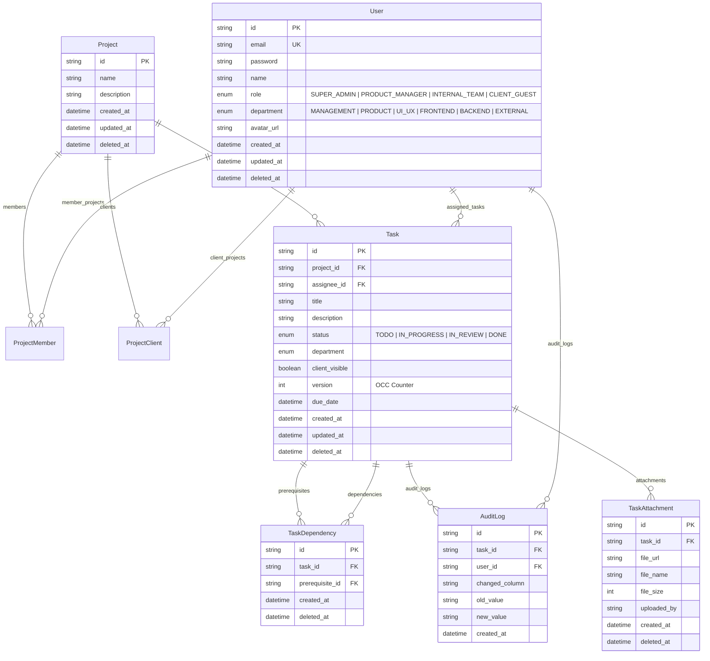
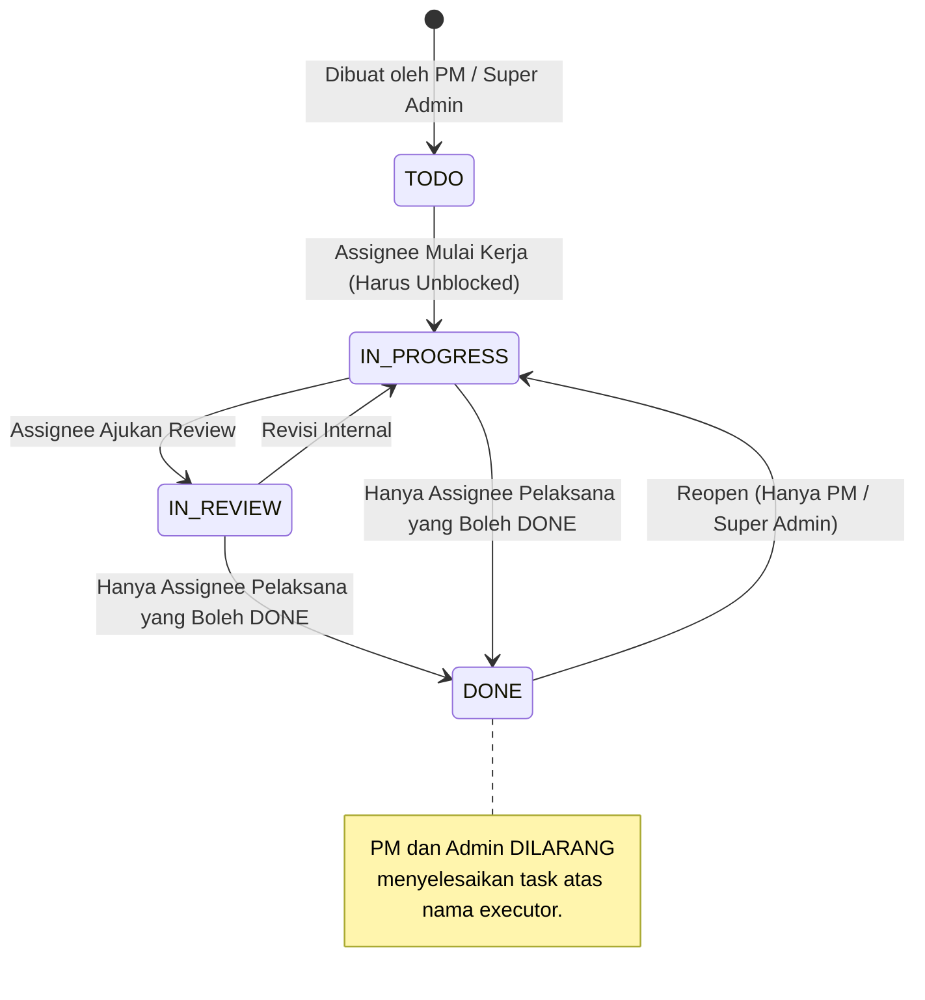

# PRODUCT REQUIREMENTS DOCUMENT (PRD)
## Relay Task Management Engine

**Document Version:** 2.0.0  
**Status:** Living Document / Active Implementation  
**Product:** Relay Task Management Engine  
**Target Environment:** Node.js 20+ (Express 5 + Prisma 6) / Next.js 16 (App Router + React 19) / PostgreSQL 17 (Alpine)

---

## 1. Executive Summary & Product Vision

### 1.1 Product Vision
**Relay Task Management Engine** adalah sistem orkestrasi deliverable proyek tingkat enterprise yang dirancang untuk mengatasi hambatan koordinasi kerja tim lintas fungsi (*Product*, *UI/UX*, *Frontend*, *Backend*) dan transparansi terhadap pemangku kepentingan eksternal (*Client Guests*).

Berbeda dari tools manajemen tugas konvensional yang bersifat pasif, Relay menerapkan **Deterministic Governance Engine**:
1. **DAG-Based Dependency Locking**: Memastikan sebuah tugas tidak dapat dieksekusi sebelum prasyarat teknisnya tuntas, sekaligus mencegah siklus melingkar (*circular dependencies*).
2. **State-Based RBAC/ABAC**: Membatasi transisi status secara ketat berdasarkan peran dan kepemilikan pekerjaan (misal: PM dilarang menyelesaikan tugas atas nama engineer pelaksana).
3. **True Optimistic Concurrency Control (OCC)**: Melindungi data dari konflik penulisan bersamaan (*lost-update problem*) melalui versioning eksplisit tingkat database (HTTP 409 Conflict).
4. **Multi-Tenant Client Guest Portal**: Mengisolasi dan menyamarkan (*masking*) identitas tim internal bagi klien, sembari memberikan visibilitas progres deliverable secara real-time.
5. **Daily Standup Intelligence**: Agregasi audit log 24 jam otomatis untuk merekap pekerjaan selesai dan mendeteksi dependensi yang terhambat.

---

## 2. User Personas & Role Matrix

Relay membagi otorisasi pengguna ke dalam 4 peran (*Roles*) dan 6 departemen (*Departments*):

### 2.1 Peran Sistem (User Roles)
| Role | Deskripsi & Tanggung Jawab Utama | Akses Portal |
| :--- | :--- | :--- |
| **SUPER_ADMIN** | Pengelola sistem tertinggi. Mengelola seluruh pengguna (CRUD), mereset kata sandi tim, mengelola proyek, dan memulihkan proyek dari arsip. | Full System, Team Admin (`/admin/users`), Settings |
| **PRODUCT_MANAGER** | Pemilik alur deliverable proyek. Membuat proyek, merancang deliverables, mengatur dependensi antar-tugas, mengelola visibilitas klien, serta mereopen task yang selesai. | Task Board, Table View, Standup Summary, Settings |
| **INTERNAL_TEAM** | Insinyur & desainer pelaksana (*UI/UX*, *Frontend*, *Backend*, *Product*). Mengeksekusi deliverable, memperbarui status pekerjaan, dan mengunggah dokumen deliverable. Dilarang mengedit judul/deskripsi atau menyelesaikan tugas orang lain. | Task Board, Table View, Standup Summary, Settings |
| **CLIENT_GUEST** | Pemangku kepentingan proyek eksternal. Memantau progres deliverable publik tanpa melihat identitas teknis insinyur internal atau tugas rahasia. | Client Portal View (`/`), Read-Only |

### 2.2 Departemen Pengguna (Departments)
- `MANAGEMENT`: Eksekutif dan Super Administrator.
- `PRODUCT`: Product Managers dan Product Owners.
- `UI_UX`: Desainer antarmuka dan riset pengguna.
- `FRONTEND`: Insinyur antarmuka web dan mobile.
- `BACKEND`: Insinyur API, arsitektur sistem, dan database.
- `EXTERNAL`: Klien luar dan mitra proyek.

---

## 3. Matriks Hak Akses & Matriks Otorisasi (RBAC / ABAC)

| Kemampuan / Fitur Sistem | SUPER_ADMIN | PRODUCT_MANAGER | INTERNAL_TEAM | CLIENT_GUEST |
| :--- | :---: | :---: | :---: | :---: |
| **Manajemen Pengguna (CRUD User)** | ✅ Penuh | ❌ Ditolak (403) | ❌ Ditolak (403) | ❌ Ditolak (403) |
| **Admin Reset Password Pengguna** | ✅ Ya | ❌ Ditolak (403) | ❌ Ditolak (403) | ❌ Ditolak (403) |
| **Self-Service Edit Profil & Password** | ✅ Ya | ✅ Ya | ✅ Ya | ✅ Ya |
| **Melihat Semua Proyek** | ✅ Ya | ✅ Ya | ❌ Hanya Proyek Terdaftar | ❌ Hanya Proyek Klien |
| **Membuat Proyek Baru** | ✅ Ya | ✅ Ya | ❌ Ditolak (403) | ❌ Ditolak (403) |
| **Soft-Delete / Arsip Proyek** | ✅ Ya | ✅ Ya | ❌ Ditolak (403) | ❌ Ditolak (403) |
| **Restore Proyek dari Arsip** | ✅ Ya | ✅ Ya | ❌ Ditolak (403) | ❌ Ditolak (403) |
| **Membuat Deliverable (Task)** | ✅ Ya | ✅ Ya | ❌ Ditolak (403) | ❌ Ditolak (403) |
| **Mengedit Metadata Task (Title, Assignee, Due Date)** | ✅ Ya | ✅ Ya | ❌ Ditolak (403) | ❌ Ditolak (403) |
| **Menambah / Menghapus Dependensi Prasyarat** | ✅ Ya | ✅ Ya | ❌ Ditolak (403) | ❌ Ditolak (403) |
| **Transisi Status: TODO -> IN_PROGRESS** | ✅ Ya | ✅ Ya | ✅ Ya (Hanya Assignee) | ❌ Ditolak (403) |
| **Transisi Status: IN_PROGRESS -> DONE** | ❌ **Ditolak** (403) | ❌ **Ditolak** (403) | ✅ Ya (Hanya Assignee) | ❌ Ditolak (403) |
| **Reopen Status: DONE -> IN_PROGRESS** | ✅ Ya | ✅ Ya | ❌ Ditolak (403) | ❌ Ditolak (403) |
| **Unggah Attachment Deliverable** | ✅ Ya | ✅ Ya | ✅ Ya (Member/Assignee) | ❌ Ditolak (403) |
| **Akses Laporan Standup Intelligence** | ✅ Ya | ✅ Ya | ✅ Ya | ❌ Ditolak (403) |
| **Akses Riwayat Lengkap Audit Log** | ✅ Lengkap | ✅ Lengkap | ❌ Terbatas Proyek Tim | ❌ Ditolak (403) |
| **Data Masking (Identitas Insinyur)** | Data Asli | Data Asli | Data Asli | **Masked Otomatis** |

---

## 4. Spesifikasi Fungsional (Functional Requirements)

### 4.1 Modul 1: Manajemen Akun & Tim (User Management & Self-Service)
- **FR-1.1 (Team Management - Super Admin):**
  - Super Admin dapat melihat daftar seluruh pengguna dengan filter peran, departemen, dan pencarian teks (nama & email) ter-debounce.
  - Super Admin dapat membuat pengguna baru dengan validasi email unik dan role valid.
  - Super Admin dapat mengedit profil pengguna (nama, email, role, departemen, URL avatar).
  - Super Admin dapat mereset kata sandi pengguna tanpa memerlukan kata sandi lama.
  - Super Admin dapat menonaktifkan pengguna (*soft delete*). Sistem memiliki penjaga bawaan: akun sendiri tidak dapat dihapus, dan Super Admin terakhir tidak dapat dihapus/di-demote.
- **FR-1.2 (Self-Service Profile & Security):**
  - Seluruh pengguna terautentikasi dapat memperbarui nama tampilan dan avatar URL dengan pratinjau instan.
  - Seluruh pengguna dapat mengganti kata sandi dengan memvalidasi kata sandi saat ini dan memenuhi standar minimal 8 karakter.

### 4.2 Modul 2: Manajemen Proyek & Siklus Hidup Workspace
- **FR-2.1 (Pembuatan Proyek):** PM dan Super Admin dapat membuat proyek baru. Sistem secara otomatis menyertakan seluruh insinyur internal aktif sebagai member awal proyek.
- **FR-2.2 (Arsip & Pemulihan Proyek):**
  - Proyek dapat diarsipkan secara aman (*soft delete*). Menghapus proyek otomatis menandai seluruh task di dalamnya sebagai terhapus.
  - Proyek terarsip dapat dipulihkan (*restore*) beserta seluruh deliverables di dalamnya dalam satu transaksi atomik.

### 4.3 Modul 3: Deliverables Engine (Kanban Board & Deliverables Table)
- **FR-3.1 (Kanban Board View):**
  - Menampilkan tugas dalam 4 kolom status (`TODO`, `IN_PROGRESS`, `IN_REVIEW`, `DONE`) dengan kartu interaktif, badge status blokir, indikator deadline, dan avatar assignee.
  - **Personal Filter ("My Tasks"):** Tombol filter personal 1-klik dengan counter badge aktif (`My Tasks [N]`) untuk menyaring deliverable yang hanya ditugaskan kepada pengguna aktif.
- **FR-3.2 (Deliverables Table View):** Tampilan tabel komprehensif didukung oleh Relay Query Engine (`ezfilter`):
  - Filter personal *"My Tasks"* yang diserialisasikan ke backend via `filters.assignee_id = user.id`.
  - Pencarian substring fleksibel pada judul dan deskripsi.
  - Filter eksak berdasarkan departemen dan status.
  - Sorting ascending/descending pada kolom utama.
  - Paginasi server-side lengkap dengan metadata `totalRows`, `totalPages`, dan `currentPage`.

### 4.4 Modul 4: Directed Acyclic Graph (DAG) Dependency Engine
- **FR-4.1 (Dependency Enforcement):**
  - Sebuah deliverable tidak dapat dipindahkan statusnya ke `IN_PROGRESS` atau `DONE` apabila masih ada tugas prasyarat yang belum berstatus `DONE`.
  - Pelanggaran menghasilkan response HTTP 422 `TASK_BLOCKED` disertai daftar tugas yang menghambat.
- **FR-4.2 (Circular Dependency Prevention):**
  - Saat menambahkan prasyarat, sistem mengeksekusi penelusuran graf DFS/BFS.
  - Jika penambahan dependensi menyebabkan siklus loop ($A \rightarrow B \rightarrow A$), request ditolak dengan HTTP 400 `CIRCULAR_DEPENDENCY`.
- **FR-4.3 (Cross-Project Guard):** Tugas tidak dapat bergantung pada tugas di luar proyek yang sama.

### 4.5 Modul 5: Concurrency Protection (True Optimistic Concurrency Control)
- **FR-5.1 (Versioning Atomik):** Setiap mutasi task mewajibkan pengiriman nilai integer `version`. Database mengeksekusi conditional update:
  `UPDATE task SET ..., version = version + 1 WHERE id = :id AND version = :sentVersion;`
- **FR-5.2 (HTTP 409 Conflict):** Jika baris terdampak bernilai 0 (berarti pengguna lain telah mengubah task tersebut terlebih dahulu), sistem mengembalikan HTTP 409 Conflict.
- **FR-5.3 (Client Resolution):** Frontend menangkap status 409 dan memunculkan modal resolusi konflik dengan opsi **"Reload Latest State"** untuk menyinkronkan data tanpa merusak integritas.

### 4.6 Modul 6: Multi-Tenant Client Guest Portal & Data Masking
- **FR-6.1 (Isolasi Tenant Klien):** Akun `CLIENT_GUEST` hanya dapat mengakses proyek yang dipetakan ke akun mereka di tabel `ProjectClient`.
- **FR-6.2 (Client Visibility Filter):** Deliverables internal yang bernilai `client_visible = false` disaring langsung di layer database.
- **FR-6.3 (Strict Data Masking):** Identitas nama insinyur internal, avatar, alamat email, dependensi teknis mendalam, dan jejak audit internal di-strip secara permanen oleh backend serializer sebelum response dikirim.

### 4.7 Modul 7: Daily Standup Intelligence
- **FR-7.1 (24-Hour Rolling Aggregation):** Agregasi audit log 24 jam terakhir secara real-time:
  - *Completed Yesterday*: Deliverable yang selesai kemarin dikelompokkan per departemen beserta nama penyelesainya.
  - *Blocked Today*: Deliverable aktif yang terblokir dependensinya.
- **FR-7.2 (Scope Selector):** Pengguna dapat melihat standup intelijen lintas seluruh proyek atau menyaring per spesifik proyek.

---

## 5. Model Data & Skema Database (ERD)

Database menggunakan PostgreSQL 17 (Alpine) yang dikelola melalui Prisma ORM dengan relasi referensial penuh:

---

## 6. Spesifikasi API Endpoint & Kontrak Sistem

Format Respons Standar:
- **Sukses:** `{ "success": true, "data": ..., "meta": ... }`
- **Error:** `{ "success": false, "error": { "code": "...", "message": "...", "details": [...] } }`

### 6.1 Autentikasi (`/api/auth`)
- `POST /api/auth/register` - Pendaftaran user baru (Zod validated).
- `POST /api/auth/login` - Autentikasi user, menghasilkan JWT cookie `HttpOnly` + response body token.
- `GET /api/auth/me` - Mengambil info user yang sedang login.
- `POST /api/auth/logout` - Membersihkan cookie autentikasi.

### 6.2 Manajemen Pengguna & Profil (`/api/users`)
- `GET /api/users/profile` - Mengambil profil user sendiri.
- `PATCH /api/users/profile` - Memperbarui nama dan avatar user sendiri.
- `PUT /api/users/change-password` - Mengganti kata sandi sendiri dengan verifikasi password lama.
- `GET /api/users/assignees` - (*PM/Admin/Internal*) List akun eligible assignee (PM & Tim Internal).
- `GET /api/users/clients` - (*PM/Admin*) List akun Client Guest terdaftar untuk penugasan proyek.
- `GET /api/users` - (*Super Admin*) List semua user dengan filter role/dept/search dan paginasi.
- `POST /api/users` - (*Super Admin*) Membuat user baru (auto-enroll ke active projects jika Tim Internal).
- `GET /api/users/:id` - (*Super Admin*) Mengambil detail user beserta metrik beban kerja.
- `PATCH /api/users/:id` - (*Super Admin*) Mengedit user.
- `DELETE /api/users/:id` - (*Super Admin*) Menonaktifkan (*soft delete*) user.
- `POST /api/users/:id/reset-password` - (*Super Admin*) Reset password user tertentu.

### 6.3 Manajemen Proyek & Kolaborator (`/api/projects`)
- `GET /api/projects` - List proyek sesuai wewenang role (ezfilter query engine).
- `GET /api/projects/archived` - (*PM/Admin*) List proyek terarsip.
- `POST /api/projects` - (*PM/Admin*) Buat proyek baru + auto-enroll anggota internal + opsional link client.
- `GET /api/projects/:id` - Detail proyek.
- `PATCH /api/projects/:id` - (*PM/Admin*) Edit info proyek.
- `DELETE /api/projects/:id` - (*PM/Admin*) Soft-delete proyek cascading ke tasks.
- `POST /api/projects/:id/restore` - (*PM/Admin*) Pulihkan proyek dan tugasnya.
- `GET /api/projects/:id/members` - List anggota internal tim dan client stakeholders proyek.
- `POST /api/projects/:id/members` - (*PM/Admin*) Daftarkan anggota tim internal ke proyek.
- `DELETE /api/projects/:id/members/:userId` - (*PM/Admin*) Hapus anggota tim internal dari proyek.
- `POST /api/projects/:id/clients` - (*PM/Admin*) Daftarkan akun Client Guest ke proyek.
- `DELETE /api/projects/:id/clients/:userId` - (*PM/Admin*) Cabut hak akses Client Guest dari proyek.
- `GET /api/projects/:id/board` - Data papan Kanban beserta dependensi terhitung.
- `GET /api/projects/:id/summary` - Metrik agregat persentase penyelesaian.
- `GET /api/projects/:id/client-view` - Tampilan portal tersanitasi khusus Klien.
- `GET /api/projects/:id/standup-summary` - Ringkasan standup per proyek.

### 6.4 Deliverables & Dependensi (`/api/tasks`)
- `GET /api/tasks` - List deliverable dengan Relay ezfilter (filter, search, sort, pagination).
- `POST /api/tasks` - (*PM/Admin*) Buat task deliverable baru.
- `GET /api/tasks/:id` - Detail task, dependensi, lampiran, dan riwayat audit.
- `PATCH /api/tasks/:id` - Mutasi task dengan OCC, State RBAC, dan audit trail.
- `PATCH /api/tasks/:id/status` - Endpoint khusus transisi status task dengan OCC.
- `DELETE /api/tasks/:id` - (*PM/Admin*) Soft-delete task.
- `POST /api/tasks/:id/dependencies` - (*PM/Admin*) Tambah dependensi (DFS cycle guard).
- `DELETE /api/tasks/:id/dependencies/:prerequisite_id` - (*PM/Admin*) Hapus dependensi.
- `POST /api/tasks/:id/attachments` - Unggah referensi berkas deliverable.

### 6.5 Laporan & Jejak Audit (`/api/reports` & `/api/audit-logs`)
- `GET /api/reports/standup-summary` - Intelijen standup harian (24 jam) lintas tim atau per proyek.
- `GET /api/audit-logs` - Riwayat mutasi data tak dapat diubah dengan query engine.

---

## 7. State Machine Deliverable & Transisi Status

---

## 8. Persyaratan Non-Fungsional (Non-Functional Requirements)

1. **Keamanan (Security Zero-Trust):**
   - Tidak ada token rahasia di `localStorage`. Autentikasi berbasis `HttpOnly; SameSite=Lax; Secure` cookie.
   - Seluruh payload request divalidasi ketat di runtime melalui skema Zod.
   - Proteksi IDOR diuji pada seluruh rute proyek dan deliverable.
2. **Kinerja & Integritas Basis Data:**
   - Seluruh mutasi ganda dibungkus di dalam transaksi atomik `prisma.$transaction`.
   - Menggunakan indeks komposit pada `(project_id, status)`, `(deleted_at)`, `(email)`, dan `(task_id, created_at)`.
   - Pencegahan N+1 query melalui eager fetching via Prisma relations.
3. **Resiliensi Pengguna (Frontend UX States):**
   - Menjamin 4 kondisi antarmuka pada setiap pemanggilan data: *Loading (Skeleton)*, *Success*, *Empty*, dan *Error (dengan tombol Retry)*.
   - Perlindungan benturan konkurensi (HTTP 409) yang ramah pengguna.
   - Debounce 300ms–350ms pada setiap filter dan input pencarian.
4. **Kualitas Kode & Otomasi Pengujian:**
   - 100% TypeScript Strict Mode.
   - Linter modern Biome (Zero ESLint/Prettier warnings).
   - Otomasi pengujian integrasi (`npm test`) yang memverifikasi aliran RBAC, DAG, OCC, dan User Management.

---

## 9. Petunjuk Khusus AI Coding Agent (AI Agent Directives & Guardrails)

Seluruh AI Coding Agent (Antigravity, Cursor, Claude Code, GitHub Copilot, Codex) yang mengoperasikan atau mengembangkan repositori ini **WAJIB** tunduk pada batasan teknis berikut:

1. **Konsistensi Framework & Versi:**
   - **Backend:** Node.js 20+ / 22 LTS, Express.js 5 (`express: ^5.3.0`), Prisma ORM 6 (`^6.4.1`), TypeScript 5.8 (ESM dengan ekstensi file `.js` pada import relatif).
   - **Frontend:** Next.js 16 (`16.3.6`, App Router), React 19 (`19.2.8`), Tailwind CSS v4 (`@tailwindcss/postcss`), Zustand 5, TanStack Query 5, Radix UI.
2. **Hukum Bisnis yang Tidak Boleh Dilanggar (Non-Negotiable Invariants):**
   - **OCC (HTTP 409):** Dilarang mengedit `Task` tanpa memeriksa `version` saat ini dan melakukan increment `version + 1`. Tabrakan versi wajib menghasilkan HTTP 409.
   - **RBAC State Machine:** Hanya `assignee` yang berhak memindahkan task ke status `DONE`. PM & Super Admin dilarang menyelesaikan tugas orang lain. Transisi *reopen* (`DONE` -> `IN_PROGRESS`) eksklusif untuk PM dan Super Admin.
   - **DAG Dependency Locking:** Task yang dependensinya belum berstatus `DONE` tidak boleh dipindahkan ke `IN_PROGRESS` atau `DONE`. Penambahan dependensi wajib lolos deteksi siklus graf BFS/DFS.
   - **Soft Delete:** Dilarang menggunakan penghapusan permanen (`DELETE FROM`). Selalu gunakan `deleted_at: new Date()` dan selalu sertakan filter `deleted_at: null` pada setiap query pembacaan data.
   - **Client Data Masking:** Data berlabel `client_visible: false` tidak boleh bocor ke `CLIENT_GUEST`. Identitas insinyur internal wajib disamarkan menjadi `Assigned Specialist`.
   - **4 UI States:** Setiap asynchronous view di frontend wajib mengimplementasikan kondisi `Loading`, `Success`, `Empty`, dan `Error`.
3. **Dokumen Referensi Utama:**
   - Panduan operasional agent lengkap: [`AGENTS.md`](./AGENTS.md)
   - Dokumentasi arsitektur mendalam: [`DOKUMENTASI_PROYEK.md`](./DOKUMENTASI_PROYEK.md)
   - Verifikasi pengujian otomatis: Jalankan `npm test` pada direktori `backend` dan `frontend`.

